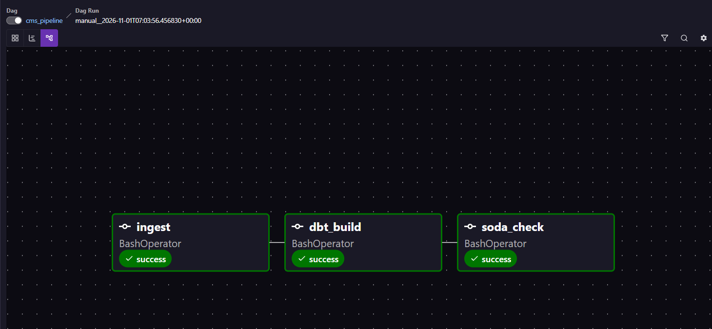

# CMS Medicare Pipeline (Airflow)

Airflow DAG that orchestrates the [CMS Medicare analysis](https://github.com/swamini-21/cms-medicare-analysis) project: ingestion, dbt build, then Soda data-quality checks, with a failure alert on every task.



## How it works

- `ingest`: runs `python -m ingestion.ingest` (idempotent: each year is deleted and reloaded in one transaction, so reruns never duplicate rows)
- `dbt_build`: runs `dbt build` (staging, marts, snapshot, tests) from a dbt virtualenv inside the Airflow image
- `soda_check`: runs Soda Core checks from a Soda virtualenv inside the Airflow image
- Retries: 2 per task, 2 minutes apart. After the final retry, an `ALERT:` line is written to the task log (`on_failure_callback`)
- Tests: `tests/dags/test_dag_integrity.py` checks that every DAG imports without errors, is tagged, and has retries configured (run with `astro dev pytest`)

## Run it

Prerequisites: Docker Desktop, [Astro CLI](https://www.astronomer.io/docs/astro/cli/install-cli), and the CMS repo cloned locally.

1. In the CMS repo, create `.env` from `.env.example`, then start Postgres: `docker compose up -d postgres`
2. In this repo, create a `.env` file:
   ```
   DB_HOST=host.docker.internal
   DB_PORT=5433
   DB_NAME=cms_project
   DB_USER=postgres
   DB_PASSWORD=<same password as the CMS repo .env>
   ```
3. Point Airflow at your CMS repo (PowerShell shown; use `export` on Mac/Linux):
   ```
   $env:CMS_PROJECT_PATH="C:/path/to/CMS_Project"
   astro dev start
   ```
4. Open http://localhost:8080, unpause `cms_pipeline` and trigger it.

## Design decisions

- dbt and Soda each run in their own virtualenv to avoid dependency clashes with Airflow.
- The DAG has no schedule (`schedule=None`): the source is two full yearly snapshots, so a daily or backfill schedule would repeat identical loads.
- Idempotency, not backfills, is what makes reruns safe here.

## What I would do next

- Replace the log-only alert with Slack or email
- Use Astronomer Cosmos to run dbt models as individual Airflow tasks
- Add a date-based source (the airline streaming data) to practice backfills